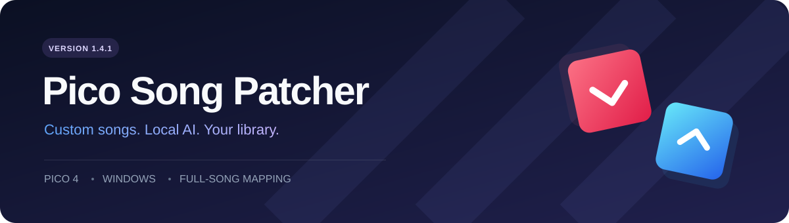

<p align="center">
  
</p>

<p align="center">
  
  
  
  
</p>

<p align="center">
  A Windows tool for custom songs, full-song AI mapping and reusable OBB builds on Pico 4.<br>
  <b>Beat Saber 1.40.8 · OVRport 3.2.2</b>
</p>

---

**Pico Song Patcher** собирает новую копию игрового кэша на ПК: добавляет готовые карты, создаёт карты из обычного аудио и сохраняет уже встроенные песни. Аудио обрабатывается локально. Перенос готовых файлов на очки выполняется вручную.

**[Скачать готовую программу для Windows x64](https://github.com/BeatPico/PicoSongPatcher/releases/download/v1.6.1/PicoSongPatcher-1.6.1-Windows-x64.zip)** · [Все выпуски](https://github.com/BeatPico/PicoSongPatcher/releases)

**В 1.6.1 исправлен резкий скачок скорости Expert и Expert+.** Скорость подлёта и время на чтение рисунка сверены со штатными картами. Чтобы обновить AI-карты из 1.6.0, выберите их, нажмите **Пересоздать AI** и соберите новый кэш.

**[Пошаговая инструкция для пользователей EXE](docs/USER_GUIDE_RU.md)** — от выгрузки кэша с очков до кнопок программы и переноса результата. В архиве есть такая же офлайн-справка `ИНСТРУКЦИЯ.html`, доступная кнопкой **Инструкция**.

Это независимый проект. Совместимость проверялась с указанной версией порта; работа с другими версиями не заявляется.

## Возможности

| | Что умеет версия 1.6.1 |
|---|---|
| **Кэш и библиотека** | Читает совместимый оригинальный или изменённый OBB, показывает штатные и добавленные песни, отмечает найденные кастомные карты для следующей сборки. |
| **Готовые карты** | Принимает совместимые ZIP и папки карт BeatSaver. Поддержка схем и требований модов проверяется при импорте. |
| **Обычная музыка** | Создаёт карты полных песен через локальный InfernoSaber. Длинные записи обрабатываются частями и объединяются. |
| **Движения** | Стены для уклонов и пригибаний, бомбы, более редкие дуги без привязки к верхнему ряду. Размещение зависит от свободного места. |
| **Повторные сборки** | Переиспользует готовые игровые данные без повторного кодирования аудио. Позволяет выбрать существующий пак вместо обязательного OST1. |
| **Управление** | Выделение мышью, Ctrl/Shift, локальное удаление и очистка песен, отсутствующих в выбранном кэше. |
| **Обучение и оценка** | Дообучение существующих весов, раздельные train/validation/test, сохранение исходной модели и полные карты для A/B-сравнения. |

## Как пользоваться

Скачайте ZIP из **[Releases](https://github.com/BeatPico/PicoSongPatcher/releases/latest)** и распакуйте **целиком** в отдельную доступную для записи папку. EXE, зависимости, отдельное CPU AI-окружение и два профиля моделей уже включены. Устанавливать Python не нужно.

1. Запустите `PicoSongPatcher-1.6.1-Windows-x64.exe`. Папки `_internal` и `ai_engine` должны оставаться рядом.
2. Выгрузите с очков совместимый OBB **и файл `espresso` из той же папки кэша**. Положите их рядом и выберите OBB в программе. Программа прочитает его содержимое и отметит уже добавленные песни. Игровые шаблоны подготовятся из вашего `espresso` при сборке.
3. Добавьте готовые карты или MP3. При необходимости выберите пак назначения.
4. Для новой генерации выберите модель, включите **Стены** и **Бомбы**, затем нажмите **Пересоздать AI**. Старые карты меняются после пересоздания.
5. Соберите кэш и откройте готовые файлы. На очки переносится **полный итоговый OBB**.

Подробности чтения кэша, удаления и завершения сборки: **[инструкция версии 1.4](README_1.4.md)**.

При первой обработке аудио нужен интернет: программа загружает FFmpeg из официального репозитория [BtbN/FFmpeg-Builds](https://github.com/BtbN/FFmpeg-Builds), сверяя размер и SHA256. Последующие запуски используют локальную копию. Собственные музыка и игровые файлы никуда не загружаются.

Публичная сборка извлекает аудио из PCM16-кэша патчера без FMOD. Для пересоздания AI из других сжатых FSB нужен исходный MP3/ZIP; обычное сохранение готовой карты декодирования не требует. Обучающие записи в выпуск не включены — для собственного дообучения подготовьте эталоны по исходникам.

## Модели: качество проверяем отдельно

AI использует отдельное окружение Python 3.11 / TensorFlow 2.15. Исходные веса и каждый эксперимент хранятся раздельно. Аудиоэнкодер, нормализация и словари при дообучении заморожены.

| Профиль | Статус |
|---|---|
| **Дообучение на 10 песнях** | Профиль для сравнения. |
| **DLC и тайминг** | Основной профиль. Дообучение плотности по официальным картам, выбор ударов по звуковым акцентам. |

Из полной записи создаются **Easy, Normal, Hard, Expert и Expert+**. Плотность и расстояния между ударами зависят от сложности. Верхний ряд используется реже. Перекрёстные движения допускаются при паузе вокруг удара и отсутствии близких стен, бомб и дуг. Пары одного цвета с одинаковой стрелкой проходятся одним взмахом.

В 1.6.1 для Expert задан подлёт **14 м/с и 950 мс** от появления блока до удара, для Expert+ — **17 м/с и 750 мс**. Минимальный интервал между отдельными взмахами одной руки — **200/160 мс** соответственно. Параметры сверены с 21 песней OST и 12 DLC, а исправление проверено на полных картах и при переводе в игровой формат. Проверки на ПК дополняют игровой тест на очках; пользовательская настройка дистанции может менять время появления блоков.

На этапе DLC использованы 19 записей. Для обучения выделены 12, для выбора весов 4 и для контрольной проверки 3. Обновлены веса плотности. Проверка тайминга выбрала исходные веса, а разреженный прогноз дополняется звуковыми акцентами. Метрики на ПК дополняют проверку удобства в очках.

**[Результаты на 40 песнях](TRAINING_RESULTS_40.md)** · [Предыдущий эксперимент](TRAINING_RESULTS.md)

## Работа с исходниками

```powershell
git clone --recurse-submodules https://github.com/BeatPico/PicoSongPatcher.git
cd PicoSongPatcher
```

InfernoSaber подключён как submodule с закреплённой ревизией. Его исходники и лицензия сохраняются отдельно от кода патчера.

| Файлы | Назначение |
|---|---|
| `app_v14.py`, `library_v14.py` | Интерфейс и локальная библиотека версии 1.4 |
| `cache_archive.py`, `cache_builder.py` | Чтение OBB, переиспользование карт и сборка |
| `neural_autogen.py`, `ai_engine/worker.py` | Запуск AI и создание полных карт |
| `ai_engine/finetune_*.py`, `ai_engine/train_model.py` | Дообучение и сборка кандидата |
| `ai_engine/evaluate_candidate.py`, `compare_audio.py` | Независимая оценка и A/B-карты |
| `collect_*examples.py`, `prepare_*examples.py`, `prepare_training_40.py` | Подбор и подготовка эталонов |
| `build_v14.py`, `package_v14.py` | Сборка полного локального комплекта |

Сценарии сборки пока рассчитаны на существующее локальное окружение и расположение ресурсов. Автоматической установки всех компонентов из чистого клона нет. Закреплённые AI-зависимости описаны в `ai_engine/requirements-windows.lock`.

На подготовленном окружении проверки обучения запускаются так:

```powershell
& .\ai_engine\runtime\python.exe -X utf8 -B .\verify_training.py
```

## Что остаётся локально

В историю Git не входят APK/OBB, игровые Unity-шаблоны, музыка, пользовательская библиотека, веса моделей, обучающие массивы, портативный Python и готовые EXE. Исполняемая программа, зависимости и разрешённые к распространению веса размещаются отдельно в **Releases**. В `assets/stock_packs.json` хранится только справочная структура штатных паков и ID.

Источники сторонних компонентов: **[THIRD_PARTY.md](THIRD_PARTY.md)**. Исходные записи и игровые ресурсы не распространяются через этот репозиторий.

## Проверки и обратная связь

Для версии 1.4 пройдены 34 проверки патчера и интерфейса, 29 проверок обучения и объектов, а также реальные локальные сборки OBB. Проверены повторная сборка изменённого кэша, перенос между паками и добавление новой карты с сохранением 29 существующих. Новые варианты генерации требуют проверки на устройстве.

При сообщении об ошибке укажите версию игры и патчера, действие перед ошибкой и её текст. Для проблем карт полезны ID BeatSaver и сложность. Не прикладывайте игровые кэши, музыку или данные своей библиотеки.

## Идеи доработок и примеры генерации

Принимаем предложения по улучшению **генерации, движений, сложности, интерфейса, библиотеки и работы с кэшем**, а также других функций программы. Пишите через **[GitHub Issues](https://github.com/BeatPico/PicoSongPatcher/issues)** — там можно обсуждать заявку и следить за её статусом.

- **[Предложить доработку](https://github.com/BeatPico/PicoSongPatcher/issues/new?template=feature_request.yml)** — опишите задачу, желаемое поведение и пример использования.
- **[Прислать удачную генерацию](https://github.com/BeatPico/PicoSongPatcher/issues/new?template=generation_good.yml)** — особенно полезны песни, у которых хорошо совпали ритм, плотность и движения.
- **[Прислать неудачную генерацию](https://github.com/BeatPico/PicoSongPatcher/issues/new?template=generation_bad.yml)** — укажите, где результат плохой: мало/много блоков, неудобные движения, дуги, стены, бомбы или попадание в ритм.

Для примера песни нужны **название и исполнитель, точная версия/ремикс или ссылка на запись, модель, сложность, BPM (авто/вручную), настройки стен и бомб**. В отзыве укажите, проверяли ли карту в очках, и таймкоды удачных или проблемных мест. Можно приложить короткое видео/скриншот или ZIP с `AI_analysis.json` и файлом сложности **без аудио**. Удачные примеры нужны так же, как неудачные: это помогает сравнивать результаты и замечать ухудшения.

Заявки публичные; отдельную почту или Telegram указывать не требуется. Формы назначают заявку владельцу проекта **BeatPico**. Предложения и присланные примеры рассматриваются в обсуждении; автоматически в обучение они не попадают.
