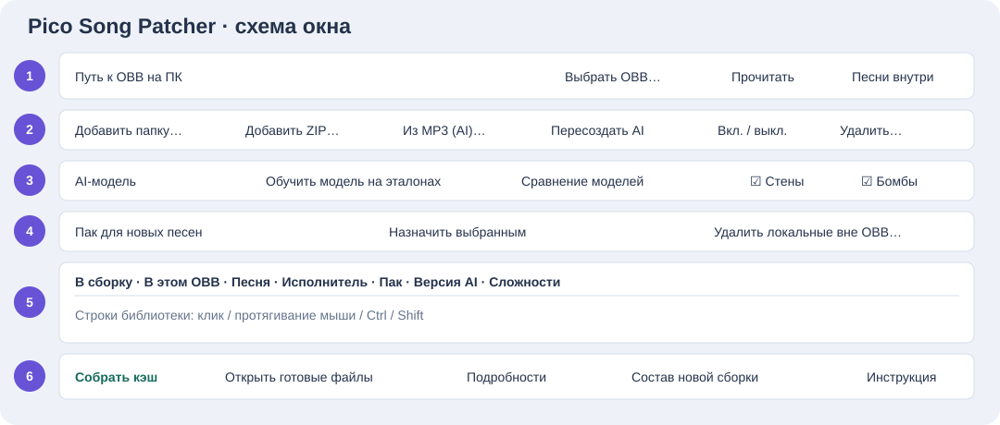

# Pico Song Patcher 1.5.3: инструкция к EXE

Программа для Windows x64 добавляет готовые карты и создаёт AI-карты из музыки для **Beat Saber 1.40.8 / OVRport 3.2.2 на Pico 4**. Она работает с локальной копией кэша. Установленная совместимая игра и собственные игровые файлы нужны отдельно.

**Первый запуск:** скачать ZIP → распаковать целиком → скопировать OBB и espresso с очков → выбрать OBB → добавить песни → собрать кэш → вручную перенести результат на очки.

[Скачать и запустить](#download) · [Выгрузить кэш](#cache) · [Кнопки](#buttons) · [Готовые карты](#maps) · [Музыка и AI](#ai) · [Собрать и перенести](#install) · [Обновить кэш](#update) · [Удалить песни](#delete) · [Ошибки](#errors)

<a id="download"></a>
## 1. Скачать и запустить

1. Возьмите архив **PicoSongPatcher-1.5.3-Windows-x64.zip**.
2. Опубликованные версии доступны в [Releases на GitHub](https://github.com/BeatPico/PicoSongPatcher/releases). В разделе **Assets** архив для Windows содержит программу, а ссылки **Source code** ведут к исходникам.
3. В Проводнике выберите **Извлечь всё**. Распакуйте весь архив в отдельную доступную для записи папку, например `D:\PicoSongPatcher`.
4. Откройте распакованную папку и запустите **PicoSongPatcher-1.5.3-Windows-x64.exe**. Храните EXE вместе с папками `_internal` и `ai_engine`.
5. Рядом лежит **ИНСТРУКЦИЯ.html**. Её также открывает кнопка **Инструкция** в программе; для чтения интернет не нужен.

В комплекте пустая библиотека, отдельное CPU AI-окружение и модели на 10 и 70 песнях. При первом использовании модели программа восстановит ссылки на общие веса. Для первой обработки аудио нужен интернет, чтобы загрузить FFmpeg с проверкой размера и SHA256. Далее обработка локальная. [BtbN/FFmpeg-Builds](https://github.com/BtbN/FFmpeg-Builds)

Оставьте свободное место для исходного кэша, нового OBB и временных файлов. С добавлением песен итоговый OBB может заметно вырасти.

<a id="cache"></a>
## 2. Где взять кэш с Pico

Для поддерживаемого порта кэш — это **два файла**:

| Файл | Как распознать |
|---|---|
| `main.1716.com.beatgames.beatsaber.obb` | Большой файл с расширением `.obb` |
| `espresso` | Файл без расширения, лежащий рядом с OBB |

1. Полностью закройте Beat Saber на очках.
2. Подключите включённые очки к ПК USB-кабелем, который поддерживает передачу данных.
3. Наденьте очки и подтвердите доступ к файлам, если появится запрос. Для USB должен быть выбран режим **Передача файлов / File Transfer**, а не только зарядка. Название и положение настройки зависят от Pico OS; в некоторых версиях она находится в разделе **Разработчик → USB-подключение**. [Официальная справка PICO о режиме File Transfer](https://developer.picoxr.com/document/unreal/pdc-faq/).
4. В Проводнике Windows откройте:

```text
Этот компьютер
└─ PICO 4
   └─ Внутренний общий накопитель / Internal shared storage
      └─ Android
         └─ obb
            └─ com.beatgames.beatsaber
               ├─ main.1716.com.beatgames.beatsaber.obb
               └─ espresso
```

5. **Скопируйте оба файла на ПК**, например в `D:\PicoCache\С_очков`. Работайте с этой копией. Дождитесь полного окончания копирования.
6. Сохраните ещё одну резервную копию этих двух файлов в отдельной папке, например `D:\PicoCache\Резервная_копия`.

Подходит кэш, в который уже добавляли песни: брать чистый оригинал каждый раз не требуется. OBB и espresso должны относиться к одной рабочей версии кэша.

**Если папок или файлов нет:** проверьте режим передачи файлов, USB-кабель, разрешение доступа в очках и версию установленной игры. Не создавайте случайные папки вместо отсутствующих и не переименовывайте OBB от другой игры. Патчер сам файлы с устройства не выгружает. Доступность `Android/obb` через USB зависит также от системы очков.

Файл `espresso` нужен для подготовки совместимых игровых шаблонов и итоговой пары файлов. В публичном ZIP игровых ресурсов нет. Чтение списка песен может работать и без espresso, но для сборки положите его рядом с выбранным OBB.

<a id="open"></a>
## 3. Открыть кэш и посмотреть песни

1. Нажмите **Выбрать OBB…** и укажите OBB **на ПК**, например `D:\PicoCache\С_очков\main.1716.com.beatgames.beatsaber.obb`.
2. Дождитесь чтения. Добавленные песни появятся в основной таблице и по умолчанию будут отмечены в столбце **В сборку**.
3. Нажмите **Песни внутри**, чтобы посмотреть все распознанные паки, штатные и добавленные песни.
4. Если путь введён или изменён вручную, нажмите **Прочитать**.

Основная таблица — библиотека добавленных карт. Штатные OST не дублируются в ней; они видны через **Песни внутри**. Песни без исходных ZIP могут получить локальную копию готовых игровых данных и переиспользоваться при следующей сборке.

<a id="buttons"></a>
## 4. Что где находится и какие кнопки нажимать



Это схема групп элементов. Поле **Арена AI** находится справа над таблицей песен.

| Область / кнопка | Действие |
|---|---|
| **1 · Выбрать OBB…** | Выбрать локальную копию исходного или уже изменённого кэша. |
| **Прочитать** | Заново прочитать файл из верхней строки. Содержащиеся в нём кастомные карты снова отмечаются для сборки. |
| **Песни внутри** | Просмотреть все распознанные паки и песни выбранного OBB; список можно сохранить из окна просмотра. |
| **2 · Добавить ZIP…** | Импортировать скачанные готовые карты. Можно выбрать несколько архивов. |
| **Добавить папку…** | Импортировать распакованную карту с Info.dat и её файлами. |
| **Из MP3 (AI)…** | Создать Easy, Normal и Hard для всей выбранной музыки. Принимает также поддерживаемые WAV, FLAC, M4A, OGG, AAC, WMA и OPUS. |
| **Пересоздать AI** | Создать новые AI-карты из аудио выделенных песен с текущей моделью и настройками объектов. |
| **Вкл. / выкл.** | Изменить отметку **В сборку** у выделенных строк. |
| **Удалить выбранные…** | Показать список и после подтверждения удалить выбранные записи и принадлежащие им локальные файлы. |
| **3 · AI-модель** | Выбрать модель для последующей генерации и пересоздания карт. |
| **Стены / Бомбы** | Включить эти объекты в новых и пересозданных AI-картах. Уже сохранённые карты от переключения галочек не меняются. |
| **Арена AI** | По умолчанию включено **Разные для песен** для новых и пересозданных AI-карт. Можно выбрать стандартную арену или конкретную сцену из OBB. Одна песня получает одну арену на всех сложностях. Повторная генерация того же файла с тем же набором арен использует тот же выбор. |
| **Сравнение моделей** | Открыть доступный отчёт выбранной дообученной модели. |
| **Обучить модель на эталонах** | Запустить дообучение по заранее подготовленной подборке. Для обычного добавления песен эта кнопка не нужна. |
| **4 · Пак для новых песен** | Выбрать существующий пак игры для новых импортов. |
| **Назначить выбранным** | Применить выбранный пак к выделенным строкам, в том числе перенести ранее встроенные песни в другой пак следующей сборки. |
| **Удалить локальные вне OBB…** | Предложить удалить записи, точных ID которых нет в выбранном кэше. Сравнение идёт с файлом на ПК. |
| **Упрощать карты с модами…** | Разрешить импорт совместимой упрощённой версии некоторых карт, убрав требования эффектов и особых правил. Результат может отличаться от авторского; не все карты удастся упростить. |
| **5 · Таблица** | Выделяйте строку кликом, диапазон протягиванием мыши или Shift, отдельные строки с Ctrl. Столбец **В сборку** отвечает за включение песни, выделение строки — за действия над ней. |
| **В этом OBB** | Показывает, найден ли точный ID этой версии карты в открытом кэше. |
| **6 · Собрать кэш** | Создать и проверить новую локальную сборку. |
| **Открыть готовые файлы** | Открыть папку результата после успешной сборки. |
| **Подробности** | Показать ID, сложности, путь и замечания выделенных карт. |
| **Состав новой сборки** | Проверить, какие добавленные песни включены и в какие паки они попадут. |
| **Инструкция** | Открыть эту справку без интернета. |

<a id="maps"></a>
## 5. Добавить готовую авторскую карту

1. Скачайте ZIP карты с [BeatSaver](https://beatsaver.com/). Авторы уже расставили в ней блоки и движения.
2. Откройте свой OBB в патчере и выберите **Пак для новых песен**.
3. Нажмите **Добавить ZIP…** и выберите архив. Распаковывать его заранее не обязательно. Для распакованного варианта используйте **Добавить папку…** и папку с `Info.dat`.
4. Дождитесь импорта. Проверьте, какие сложности появились, и прочитайте замечания, если они есть.
5. Убедитесь, что песня отмечена **В сборку**.

Для такого импорта нейросеть и кнопка дообучения не нужны. Некоторые карты требуют игровых модов, которые патчер не устанавливает. Ошибка конкретной сложности не означает, что обработаны все остальные: проверяйте список сложностей после импорта.

<a id="ai"></a>
## 6. Сделать карту из обычной музыки

1. В поле **AI-модель** выберите профиль на **10** или **70** песнях. Профиль на 70 продолжает обучение модели на 40 песнях.
2. Выберите пак назначения и **Арену AI**. Включите **Стены** и **Бомбы**, если хотите эти объекты. Игра может подставлять свою арену, если в её настройках включено переопределение окружения.
3. Нажмите **Из MP3 (AI)…** и выберите одну или несколько аудиозаписей.
4. В окне BPM оставьте **Авто**, если темп неизвестен. Число от 40 до 320 применяется ко всем выбранным файлам, поэтому разные известные BPM задавайте отдельными запусками.
5. Дождитесь завершения по журналу внизу окна. Обрабатывается полная запись; для длинных песен AI использует части с контекстом.
6. В библиотеке появятся AI-карты со сложностями **Easy, Normal, Hard**. Затем соберите кэш.

Стены создаются для боковых уклонов и пригибаний в подходящих местах. Количество стен, бомб и дуг зависит от песни и сложности. Галочки не гарантируют одинакового числа объектов в каждом треке.

### Изменить уже созданную AI-карту

Выделите песни → выберите модель и галочки объектов → **Пересоздать AI** → дождитесь окончания → **Состав новой сборки** → **Собрать кэш**. Для новых настроек нужна новая генерация; простое переключение галочки не переделывает старые карты.

Пересоздание использует аудио, а не авторскую расстановку блоков. Для карты из сжатого FSB, который публичная сборка не декодирует, понадобится исходный MP3/ZIP. Если готовая карта уже есть в кэше и её менять не нужно, её можно сохранить без извлечения аудио.

### Кнопка обучения

**Обучить модель на эталонах** предназначена для отдельного подготовленного набора. Она не берёт выделенные библиотечные песни в качестве примеров автоматически. Обучающие записи и подготовленные массивы в публичный ZIP не входят. Простому пользователю для добавления песен обучать модель заново не требуется.

<a id="packs"></a>
## 7. Куда попадут песни в игре

Для новых песен заранее выберите **Пак для новых песен**. Чтобы поменять пак у уже добавленных строк: выделите их, выберите пак и нажмите **Назначить выбранным**.

Ранее встроенные песни сохраняют свои паки, пока вы явно не назначите другой. Используются существующие паки, распознанные в выбранном OBB. Папка в Проводнике не создаёт новый раздел меню игры.

Перед сборкой нажмите **Состав новой сборки**. После сборки соответствие песен пакам есть в `ПЕСНИ_В_КЭШЕ.txt` в папке результата.

<a id="install"></a>
## 8. Собрать кэш и перенести на очки

1. Проверьте отметки **В сборку**. Неотмеченные кастомные карты не включаются в следующую сборку; штатные песни сохраняются.
2. Нажмите **Состав новой сборки** и проверьте список.
3. Нажмите **Собрать кэш**. Дождитесь сообщения **Готово**. Этап проверки может занять время после записи большого файла.
4. Нажмите **Открыть готовые файлы**. В папке результата лежат инструкция, список песен, отчёт и папка `Android`.
5. Откройте внутри результата:

```text
Android\obb\com.beatgames.beatsaber\
├─ main.1716.com.beatgames.beatsaber.obb
└─ espresso
```

6. На очках полностью закройте игру. Убедитесь, что у вас есть резервная копия прежних **обоих** файлов.
7. Через Проводник скопируйте **эту готовую пару** в `PICO 4 → Внутренний общий накопитель → Android → obb → com.beatgames.beatsaber`, заменив одноимённые файлы. На очки отправляется полный OBB.
8. Дождитесь завершения копирования. Запустите игру, откройте выбранный пак и проверьте новую песню и нужную сложность.

Не смешивайте OBB из одной новой сборки с espresso из другой. Сам патчер устройство не перезаписывает и APK игры не устанавливает. Прохождение проверок на ПК не заменяет игровой тест.

### Если результат не подошёл

Закройте игру и верните на очки сохранённую резервную пару OBB + espresso. Локальную библиотеку патчера для этого удалять не нужно.

<a id="update"></a>
## 9. Добавить песни в следующий раз

1. Выберите актуальный совместимый OBB, который уже содержит ваши песни: можно использовать сохранённый результат последней сборки или свежую копию с очков.
2. Держите соответствующий espresso рядом с ним. Нажмите **Прочитать**.
3. Найденные кастомные карты отметятся для включения. Добавьте новые песни или снимите отметки с ненужных.
4. Соберите новый кэш и вручную перенесите готовую пару на очки.

Готовые игровые данные переиспользуются, поэтому заново добавлять исходные ZIP и перекодировать каждую старую песню не нужно. Перенос по USB всё равно выполняется полным итоговым OBB.

<a id="delete"></a>
## 10. Исключить или удалить песни

**Убрать песню из следующего кэша:** снимите отметку **В сборку** и соберите новый OBB. Это позволяет оставить исходник в локальной библиотеке.

**Удалить с ПК:** выделите строки → **Удалить выбранные…** → проверьте имена и пути в подтверждении → подтвердите. Удаляются принадлежащие им локальные файлы, поэтому заранее сохраните нужные исходники.

**Очистить локальные песни, которых нет в актуальном кэше:** сначала выберите и прочитайте нужный OBB → **Удалить локальные вне OBB…** → просмотрите список. Сравнение идёт с выбранным файлом на ПК по точным ID версий карт, а не с живым содержимым очков. Старая и новая генерации одной песни имеют разные ID.

Локальное удаление не меняет исходный OBB и устройство. Если затем вновь прочитать кэш, в котором песня по-прежнему есть, она снова появится в библиотеке. Для удаления из кэша нужно исключить её из сборки, собрать результат и перенести его на очки.

<a id="errors"></a>
## 11. Частые вопросы и ошибки

| Ситуация | Что проверить |
|---|---|
| **PICO не видно в Проводнике** | Очки включены; кабель передаёт данные; разрешён доступ к файлам; выбран File Transfer. Стриминг игры на ПК не означает, что передача файлов включена. |
| **Не вижу com.beatgames.beatsaber / нужных файлов** | Версию игры, путь `Android/obb`, доступ к файлам. Не подставляйте кэш от другой версии или другой игры. |
| **Нужен espresso** | Скопируйте файл без расширения из той же папки кэша очков и положите рядом с выбранным OBB на ПК. |
| **Пустая основная таблица, но в игре есть OST** | Штатные песни смотрите через **Песни внутри**. Основная таблица содержит добавленные карты. |
| **Песни есть в OBB, но не отмечены** | Проверьте выбранный путь и нажмите **Прочитать**. Столбец **В этом OBB** сравнивает конкретные ID, а не только название песни. |
| **ZIP импортировался с замечаниями** | Откройте **Подробности**, проверьте оставшиеся сложности и требования модов. При необходимости скачайте другую совместимую карту. |
| **В игре No data / нет кнопки начать** | Проверьте, что перенесены оба файла из одной завершённой сборки, версия игры совпадает и выбрана поддержанная сложность. Попробуйте другую авторскую карту или новую AI-карту из исходного аудио. Для сообщения об ошибке сохраните ID карты и текст отчёта. |
| **После включения стен или бомб ничего не поменялось** | Выделите старые AI-карты и нажмите **Пересоздать AI**, затем соберите и перенесите новый кэш. |
| **Не удалось скачать FFmpeg** | Интернет и доступ к GitHub; повторите обработку. При ошибке контрольной суммы непроверенная загрузка не запускается. |
| **Отказано в доступе / WinError 5** | Папка программы и output доступны для записи; исходные/готовые файлы не открыты другой программой. Дождитесь завершения сборки. Если программа сообщила готовый путь в рабочей папке с `ГОТОВО.txt`, используйте этот проверенный результат. Папку с `СБОРКА_НЕ_ГОТОВА.txt` на очки не переносите. |
| **Слишком много или мало блоков** | Сначала сравните Easy/Normal/Hard. Попробуйте другой профиль модели и пересоздание. |
| **Перенос занимает много времени** | OBB копируется полностью; размер растёт с числом песен. Дождитесь завершения операции и проверьте свободное место. |

## 12. Что приложить к сообщению об ошибке

Сообщайте в [Issues проекта](https://github.com/BeatPico/PicoSongPatcher/issues): версию патчера и порта, действие перед ошибкой, текст ошибки, ID BeatSaver и сложность, если проблема в карте. Для сбоя обработки журнал или ошибка сохраняются в папке `data` (`logs`, `last_error.txt`, `last_import.txt` — в зависимости от операции).

Перед публикацией журнала удалите личные пути и названия, которыми не хотите делиться. Не загружайте игровые кэши, музыку и всю свою библиотеку.
